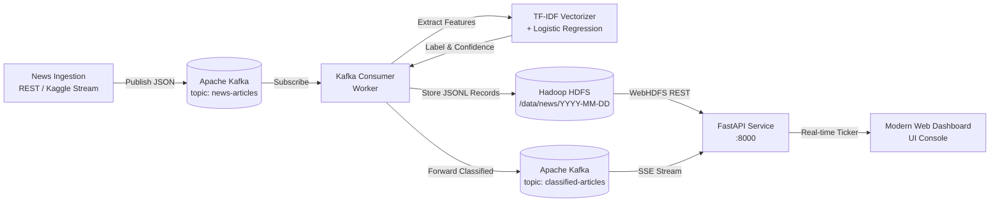

# 📰 Fake News Classification Pipeline
### Real-Time Ingestion with Kafka, Storage on Hadoop HDFS, and NLP Credibility Classification

[](https://www.docker.com/)
[](https://kafka.apache.org/)
[](https://hadoop.apache.org/)
[](https://fastapi.tiangolo.com/)
[](https://www.python.org/)
[](LICENSE)

---

## 📌 Problem Statement & Objective

> **Problem Statement:**  
> Manual fact-checking cannot keep pace with the exponential volume of digital news published daily, allowing misinformation and manipulated content to spread across platforms before it is ever flagged or verified.

> **Objective:**  
> Ingest news articles continuously via **Apache Kafka**, persist raw and classified records into **Hadoop Distributed File System (HDFS)** date partitions, and train a high-accuracy text-classification model (**TF-IDF + Logistic Regression / Naive Bayes**) that labels each article as **reliable** or **unreliable** along with a calibrated **confidence score**, exposed through a real-time **REST API** and interactive glassmorphic dashboard.

---

## 🏗️ Architecture & Dataflow Pipeline



### Key Components

1. **Apache Kafka (KRaft Mode)**:
   - Self-contained Kafka 3.7 broker running without external Zookeeper dependencies.
   - Topics: `news-articles` (raw incoming stream) and `classified-articles` (enriched results).
2. **Hadoop Distributed File System (HDFS)**:
   - NameNode & DataNode containers with WebHDFS REST API enabled (`:9870`).
   - Automatically date-partitioned storage: `/data/news/YYYY-MM-DD/articles.jsonl`.
   - Fault-tolerant buffer with automatic sync if HDFS initializes in SafeMode.
3. **Machine Learning & NLP (TF-IDF + Classification)**:
   - **Feature Extraction**: Sublinear TF-IDF with bi-grams (`ngram_range=(1,2)`), English stopword elimination, and vocabulary sizing (`max_features=10,000`).
   - **Models**: Calibrated **Logistic Regression** (Primary: **99.38% Test Accuracy**, **99.38% F1-score**) and **Multinomial Naive Bayes** (**98.62% Test Accuracy**).
   - **Explainability**: Extracts top vocabulary token weights influencing each article classification.
4. **FastAPI Backend & Interactive Dashboard**:
   - High-throughput asynchronous REST API exposing prediction, ingestion, HDFS file inspector, metrics, and live **Server-Sent Events (SSE)**.
   - Sleek dark-mode glassmorphic dashboard with live news ticker, interactive fact-checking sandbox, and HDFS data lake explorer.

---

## 📊 Dataset

This project utilizes the **Kaggle Fake News Detection Dataset** (`emineyetm/fake-news-detection-datasets`) and includes LIAR schema support:
- `True.csv` (Reliable real-world news articles from Reuters and major verified press wires)
- `Fake.csv` (Unreliable fabricated articles, conspiracy posts, and satirical disinformation)

The dataset can be downloaded automatically via `kagglehub`:
```python
import kagglehub

# Download latest version
path = kagglehub.dataset_download("emineyetm/fake-news-detection-datasets")
print("Path to dataset files:", path)
```
*Note: A curated 2,000-article sample is pre-bundled in `data/sample/` so the pipeline is fully functional immediately out of the box even without internet connectivity.*

---

## 🚀 Quickstart: One-Command Startup (Docker)

Ensure **Docker Desktop** is running, then clone and run:

```bash
# 1. Clone the repository
git clone https://github.com/cheeseburden/proj.git

# 2. IMPORTANT: Navigate into the project folder
cd proj
```

Then start the pipeline with a single command:

### Option A — One-Click Scripts:
- **Windows**: Double-click or run `run.bat`
- **Linux / macOS**: Run `chmod +x run.sh && ./run.sh`

### Option B — Direct Docker Compose:
```bash
docker compose up --build -d
```
*(or `docker-compose up --build -d` on older systems)*

---

## 🌐 Service Endpoints

| Service | Endpoint | Description |
|---|---|---|
| **Web Dashboard** | [http://localhost:8000](http://localhost:8000) | Interactive Fact-Checker & Live Kafka Stream |
| **Swagger API Docs** | [http://localhost:8000/docs](http://localhost:8000/docs) | Interactive OpenAPI / Swagger UI |
| **HDFS NameNode UI** | [http://localhost:9870](http://localhost:9870) | Hadoop Cluster Health & WebHDFS Explorer |
| **Kafka Host Broker** | `localhost:29092` | Direct Kafka Producer / Consumer access |

---

## 📡 REST API Reference

### 1. Classify Article Credibility
`POST /api/predict`

**Request:**
```json
{
  "title": "Reuters: Senate passes bipartisan infrastructure funding bill",
  "text": "WASHINGTON (Reuters) - The U.S. Senate approved a sweeping $1 trillion budget bill on Friday with broad bipartisan support.",
  "subject": "politics"
}
```

**Response:**
```json
{
  "label": "reliable",
  "is_reliable": true,
  "confidence": 0.9384,
  "probabilities": {
    "reliable": 0.9384,
    "unreliable": 0.0616
  },
  "top_signals": [
    {"word": "reuters", "impact": 0.7885, "indication": "reliable"},
    {"word": "senate", "impact": 0.3155, "indication": "reliable"},
    {"word": "bipartisan", "impact": 0.1015, "indication": "reliable"}
  ],
  "word_count": 30
}
```

---

### 2. Ingest Article into Kafka Pipeline
`POST /api/ingest`

**Request:**
```json
{
  "title": "BREAKING: Secret Video Proves Aliens Control Weather Systems!!",
  "text": "Shocking leaked recordings from anonymous whistleblowers expose lunar secrets.",
  "subject": "news",
  "source": "api_client"
}
```

**Response:**
```json
{
  "status": "ingested_and_classified",
  "article_id": "art_176055849",
  "classification": {
    "label": "unreliable",
    "confidence": 0.753,
    "is_reliable": false
  }
}
```

---

### 3. Server-Sent Events (SSE) Live Feed
`GET /api/stream`

Streams continuous real-time classified news articles as they flow off Kafka into HDFS.

---

### 4. Inspect HDFS Lake Files
`GET /api/hdfs/files`

Returns listing of all date-partitioned JSONL files on the Hadoop cluster.

---

### 5. Pipeline Analytics & Model Metrics
`GET /api/metrics`

Returns evaluation metrics (Accuracy, Precision, Recall, F1, ROC-AUC, Confusion Matrix) and live stream throughput statistics.

---

## 🔬 Local Development & Testing

If you wish to run components individually outside Docker:

```bash
# 1. Install dependencies
pip install -r requirements.txt

# 2. Download Kaggle Dataset
python scripts/download_dataset.py

# 3. Train Model
python src/ml/train.py

# 4. Run Integration Self-Test
python scripts/test_pipeline.py

# 5. Start API Server
uvicorn src.api.main:app --host 0.0.0.0 --port 8000 --reload
```

---

## 📈 Model Performance Benchmark

Evaluated on held-out 20% test split:

| Metric | Logistic Regression (TF-IDF) | Multinomial Naive Bayes |
|---|---|---|
| **Accuracy** | **99.38%** | 98.62% |
| **F1 Score** | **99.38%** | 98.62% |
| **Precision** | **99.01%** | 98.99% |
| **Recall** | **99.75%** | 98.25% |
| **ROC-AUC** | **99.99%** | 99.91% |

---

## 📦 Repository Structure

```
├── docker-compose.yml           # Unified multi-container Docker specification
├── Dockerfile                   # Python 3.11 multi-service image
├── requirements.txt             # Python project dependencies
├── run.bat                      # One-click startup script for Windows
├── run.sh                       # One-click startup script for Linux/macOS
├── README.md                    # Comprehensive technical documentation
├── scripts/
│   ├── download_dataset.py      # Automated dataset downloader via kagglehub
│   └── test_pipeline.py         # End-to-end integration test
├── src/
│   ├── config.py                # Centralized environment configuration
│   ├── ml/
│   │   ├── preprocess.py        # Text normalization & NLP token cleaner
│   │   ├── train.py             # Model training (TF-IDF + LogReg / Naive Bayes)
│   │   └── predictor.py         # Inference engine with confidence & explainability
│   ├── storage/
│   │   └── hdfs_client.py       # WebHDFS client with fault-tolerant local buffer
│   ├── streaming/
│   │   ├── kafka_producer.py    # Kafka news publisher & simulator
│   │   └── kafka_hdfs_consumer.py # Kafka consumer -> ML classifier -> HDFS writer
│   └── api/
│       ├── main.py              # FastAPI server with REST & SSE endpoints
│       └── static/              # Glassmorphic frontend dashboard (HTML, CSS, JS)
└── data/
    ├── sample/                  # Curated sample dataset for immediate execution
    └── models/                  # Serialized trained model, TF-IDF vectorizer & metrics
```

---

## 📜 License
Distributed under the MIT License. Built for modern real-time big data pipelines.
